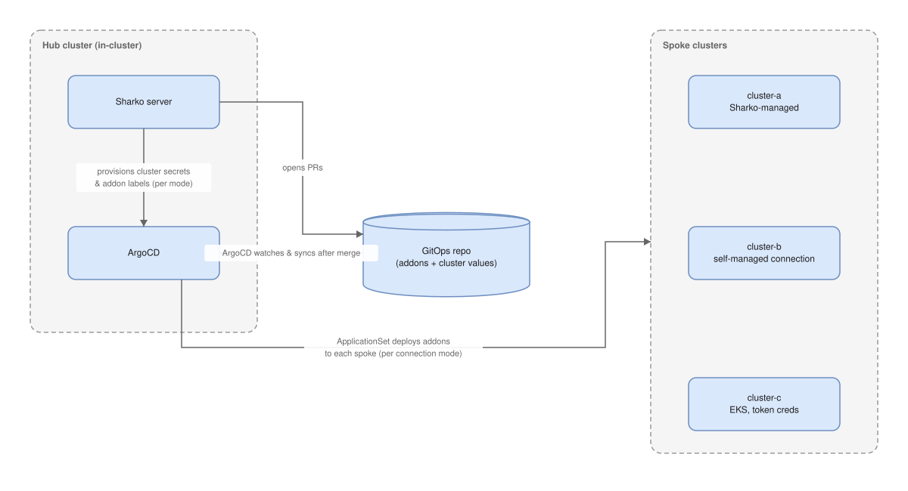
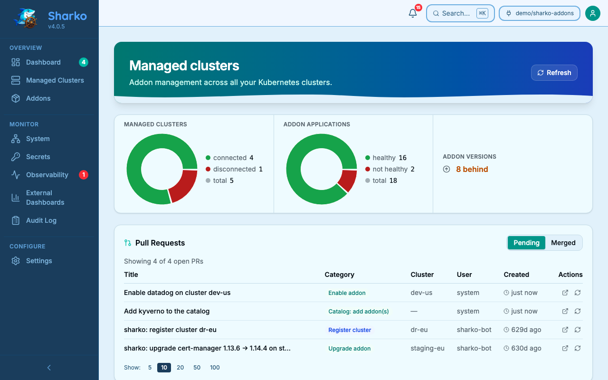

# Sharko

<p align="center">
  
</p>

<p align="center"><em>Addon management for Kubernetes clusters, built on Argo CD.</em></p>

!!! warning "Sharko v4 is a technical preview, for evaluation and staging environments. It is not supported in production."
    Start with the
    [latest published v4 release](https://github.com/MoranWeissman/sharko/releases/latest)
    and read the [current limitations](technical-preview.md) before deploying it
    more widely.

<!-- TODO: add a short GIF or video of the UI here once the demo video is published. -->

## What is Sharko?

Sharko helps you run the same addons on many Kubernetes clusters. Addons are things like
cert-manager, monitoring and logging. You pick which addons go on which cluster, from a web
page, a command line tool, or a REST API.

Sharko does not install the addons itself. It writes small files into your Git repo, and
[Argo CD](glossary.md#argo-cd) reads that repo and does the installing.

## Why use it

- **One place for all your clusters.** See every cluster and which addon version runs where.
- **Every change goes through Git.** Sharko opens a pull request for each change, so you can look
  at it first. You can see the exact file changes before the pull request is opened, with secret
  values hidden.
- **Your repo stays simple.** It holds a few small YAML files, not templates you have to keep up.
- **You can stop using Sharko.** If you remove it, every addon keeps running, because Argo CD was
  always the one installing them from Git. See [If You Remove Sharko](operator/removing-sharko.md).

## Quick start

You need a Kubernetes cluster with Argo CD on it, and Helm 3.

Install Sharko, read the first admin password, and open the web page:

```bash
helm install sharko oci://ghcr.io/moranweissman/sharko/sharko \
  --namespace sharko --create-namespace

kubectl get secret sharko-initial-admin-secret -n sharko \
  -o jsonpath='{.data.password}' | base64 -d

kubectl port-forward svc/sharko 8080:80 -n sharko
```

Then go to [http://localhost:8080](http://localhost:8080) and log in as `admin` with that
password. A setup wizard walks you through connecting your Git repo and Argo CD.
The [Quick Start](getting-started/quickstart.md) page has every step.

## How it works



Sharko and Argo CD run on one main cluster (the "hub" in the picture). Sharko writes your
choices into Git, and Argo CD installs the addons on your managed clusters (the "spokes").

Your Git repo holds these files:

- `catalog.yaml`: the addons your team has approved.
- `managed-clusters.yaml`: the clusters Sharko looks after.
- `cluster-addons/<cluster-name>.yaml`: which addons are on for each cluster.
- `values/`: the Helm settings for each addon.
- `sharko-engine.yaml`: which version of Sharko's engine chart to use.

The engine chart, [`sharko-engine`](https://github.com/MoranWeissman/sharko/tree/main/charts/sharko-engine),
holds all the logic that turns these files into Argo CD Applications. It is signed and has a version
number. When a new engine comes out, you get a small pull request that changes that version
number.

Apart from its own settings, Sharko changes only two things directly, without Git: the Argo CD
connection for each managed cluster, and the secrets that some addons need. Every change to
your addons goes to Git first.

New to these words? See the [Glossary](glossary.md).

## Features

- A dashboard with the health of each cluster and the addon versions on it.
- A setup wizard that connects Git and Argo CD and sets up your repo.
- Take over clusters that Argo CD already knows about, in one click.
- A preview of the exact file changes before any pull request is opened.
- One REST API behind the web page and the command line tool. Your own tools can call it too,
  with API keys.
- Addon secrets sent to your clusters from AWS Secrets Manager or Kubernetes Secrets.
- An optional AI helper for finding problems. It works with OpenAI, Claude, Gemini or Ollama.

{ loading=lazy }

## Project status

Sharko v4 is a technical preview. You can try it on test and staging clusters and tell us
what you find. Read [Current Limitations and Supported Use](technical-preview.md) to see what
works today and what does not. Changes in each version are in the
[Release Notes](release-notes.md).

<div class="grid cards" markdown>

-   :material-rocket-launch:{ .lg .middle } **Getting Started**

    ---

    Install Sharko and add your first cluster.

    [:octicons-arrow-right-24: Quick Start](getting-started/quickstart.md)

-   :material-book-open:{ .lg .middle } **User Guide**

    ---

    Everyday work: clusters, addons, values, upgrades.

    [:octicons-arrow-right-24: Read the guide](user-guide/clusters.md)

-   :material-tools:{ .lg .middle } **Operator Manual**

    ---

    Install, set up, secure and fix a Sharko server.

    [:octicons-arrow-right-24: Operator docs](operator/installation.md)

-   :material-console:{ .lg .middle } **API Reference**

    ---

    Every API endpoint, made from the code.

    [:octicons-arrow-right-24: API docs](api/overview.md)

</div>

## Try it without a cluster

If you want to look around first, the demo mode runs Sharko on your own computer with fake
Argo CD, Git and secrets. It needs Go and Node.js:

```bash
git clone https://github.com/MoranWeissman/sharko.git
cd sharko
make demo
```

Open [http://localhost:8080](http://localhost:8080) and log in with `admin` / `admin`.
