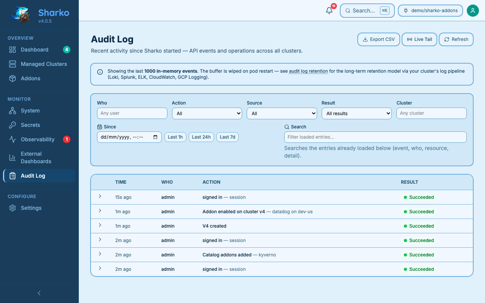

# Activity History — what Sharko keeps and for how long

> **This page explains how things work. It is not a fix-it guide.** It says
> where Sharko's Activity History lives, how long it lasts, and what you
> can and cannot do about that. If you are trying to fix a certain error,
> search [`failure-mode-index.md`](failure-mode-index.md) for your error
> message instead.

Sharko adds an entry to the Activity History for every request that changes
something: registering a cluster, adding, removing or upgrading an addon,
delivering secrets, first-run setup, and incoming webhooks.

!!! danger "The Activity History is kept in memory only. A restart loses all of it."
    Sharko keeps the **last 1000 entries** in memory and writes them
    nowhere else. There is no disk, no database, no volume and no log
    stream. Any restart empties it completely. **Do not rely on it as your
    record of what happened.** See
    [Technical preview](../technical-preview.md#4-the-activity-history-lives-in-memory-and-is-gone-when-sharko-restarts).

## Where the entries go

| Where | How long it lasts |
|-------|----------|
| The Activity page in the UI | The last 1000 entries, since this pod started |
| `GET /api/v1/audit` | The same list |
| `GET /api/v1/audit/stream` | A live feed of new entries, while you stay connected |

All three read the same list in memory. There is no fourth place.

Each entry has `id`, `timestamp`, `event`, `user`, `action`, `resource`,
`source`, `result`, `duration_ms`, `changes`, `attribution_mode` and
`tier`. The fields of each API call are in the
[API reference](../api/reference.md).

### The `changes` field

`changes` says if the action behind the entry really changed anything.
This is not the same as `result`, which says if the action finished:

| `changes` | Meaning |
|-----------|---------|
| `not_applicable` | A check that only reads. Nothing was ever going to change. |
| `none` | An action ran and, on purpose, wrote nothing. |
| `applied` | Something really changed. |
| `may_be_applied` | The action stopped part-way and nothing was undone, so some changes may already be in place. Go and look. |
| missing | The part of Sharko that wrote the entry did not say. The UI then shows nothing, and never "no changes made". |

{ loading=lazy }
<figcaption>The Activity History page, showing the entries kept in memory and the filters.</figcaption>

## What "lost on restart" means in practice

The list lives inside the Sharko program. Anything that restarts the pod
empties it: a new image, a node drain, the pod running out of memory, or
`kubectl rollout restart`. Those entries are gone. You cannot get them back
from anywhere.

The Activity page says so at the top, so nobody reads an empty page as
"nothing has happened".

The limit of 1000 entries is fixed in the code. There is no setting and no
environment setting for it, so nothing you put in `extraEnv` changes it.
When a busy Sharko passes 1000 entries, it drops the oldest ones, restart
or no restart.

## If you need a record that survives

**Sharko cannot give you one today, and no setting changes that.** Keeping
the Activity History across restarts is real work that is not done. It is
part of a bigger question about what else Sharko should remember across
restarts, so it is not a small change.

What you have outside Sharko, and what each one really covers:

- **Your Git repository.** Every change Sharko makes to what runs on your
  clusters goes through a commit and a pull request. Your Git host keeps
  those for as long as you keep the repository. Today this is the most
  complete record of *what changed*, and it says who asked for it. See
  [Git attribution](../user-guide/attribution.md). It does **not** cover
  reads, failed attempts, sign-ins, or anything Sharko does that does not
  change the repository.
- **Kubernetes Events.** Sharko writes Events when things work and when they
  fail. See [Sharko Events](sharko-events.md). Your cluster keeps Events
  only for a short time (an hour by default on many clusters), unless you
  send them somewhere else. They cover different things from the Activity
  History, not the same things.
- **Sharko's own pod log.** Sharko writes a lot to its log as it works, and
  your log system keeps that. **These are plain log lines, not Activity
  History entries.** They do not have the fields above, and no search turns
  them into the same list. Use them as background when you look into a
  problem, not as a record.

None of these three takes the place of the Activity History. If you must be
able to answer "who changed this, and when" weeks later, Sharko cannot
answer that today.

## Related

- [Technical preview](../technical-preview.md) — this limit, next to the
  other things to know before you trust Sharko
- [Troubleshooting](troubleshooting.md) — more help with logs and debugging
- [Security](security.md) — how Sharko is kept safe, and where it is not
- [Configuration](configuration.md) — the settings Sharko really reads
