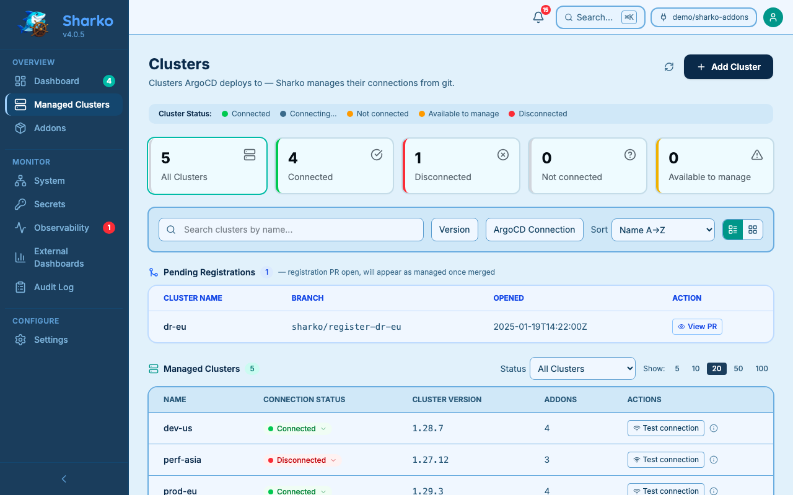
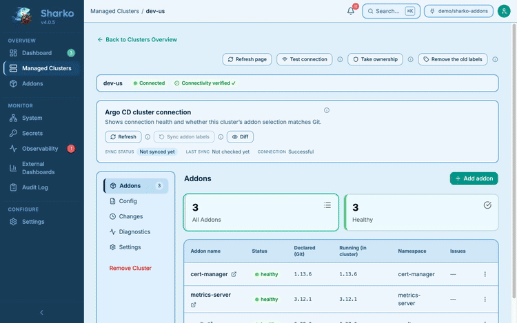

# Managing Clusters

This page shows you how to register clusters with Sharko, enable addons on them, and test their connections.

## What you'll do

- Register new clusters
- Enable and disable addons on clusters
- Test cluster connectivity
- View cluster health and status

## What you need

- Admin or Operator role in Sharko
- Cluster credentials (kubeconfig or IAM role for EKS)
- The cluster must be reachable from where Sharko runs

---

Clusters are the units of deployment in Sharko. Each registered cluster gets a line in `managed-clusters.yaml` and its own addon file, `cluster-addons/<name>.yaml`, in the addons repo. ArgoCD manages addon deployments for it via the ApplicationSet.

{ loading=lazy }
<figcaption>Cluster detail — deployed addons, per-cluster values overrides, and pending PRs.</figcaption>

{ loading=lazy }
<figcaption>Enabling datadog on cluster dev-us: select the addon, preview file changes, and open a pull request.</figcaption>

## Who owns the cluster connection

**Sharko owns cluster connections.** That is the normal, supported way. When Sharko registers a cluster, it creates the ArgoCD cluster Secret and keeps its credentials up to date.

- **Adopt** and **Take ownership** are for connections that already exist and that nothing else keeps managing. For example, a connection you made by hand, with `argocd cluster add`, or with a script you ran one time.
- **A connection that a GitOps tool keeps managing is not supported.** That means an ArgoCD Application, External Secrets, or any other controller that writes the Secret again and again.
- Sharko refuses some of these. It stops when the Secret carries another tool's ownership label, or an ArgoCD mark that clearly shows an Application renders this exact Secret. It does not look for External Secrets, so it may not notice it. Details are in [Managing Cluster Connections Yourself](../operator/self-managed-connections.md).

!!! warning "Anything else that manages the connection Secret can fight with Sharko"
    Sharko puts its addon labels on the connection Secret. If something else also manages that Secret (External Secrets, an ArgoCD Application, Terraform, a script), it may remove those labels each time it writes the Secret. Sharko checks the Secret again and again and puts the labels back. Then the two undo each other, and addons can be removed and put back again. If that Application uses `syncOptions: [Replace=true]`, or sets one of Sharko's addon label keys, it is worse. See [Managing Cluster Connections Yourself](../operator/self-managed-connections.md).

## Managed vs Discovered Clusters

Sharko distinguishes between two types of clusters:

| Type | Description |
|------|-------------|
| **Managed** | Listed in `managed-clusters.yaml` in your Git repo. Full lifecycle management: addons, upgrades, secrets reconciliation. |
| **Discovered** | Found in ArgoCD but not listed in `managed-clusters.yaml`. Sharko shows these as read-only and offers **Adopt** and **Take ownership**. |

In the API, every cluster entry includes a `"managed": true/false` field. In the UI, the Clusters page shows managed clusters as the main list; Discovered clusters are collapsed into a single line under the page title, for example "3 clusters ArgoCD already knows that Sharko doesn't manage yet." If you are an admin, the count is a link. Click it to open **Add Cluster** with **Connection managed by** set to **Manage a cluster ArgoCD already connects to**. Other users see the same line, but as plain text. When you open a discovered cluster, its page says **Sharko doesn't manage this cluster yet**, with an **Adopt** button and a **Take ownership** button.

## Preview Changes Before a PR Opens

Sharko is a GitOps agent: every change it makes to your GitOps repository goes through a pull request — it never mutates live state. Before opening that PR, the UI offers a **"Preview changes"** button on every PR-opening operation.

Clicking **Preview changes** runs a server-side dry-run (no branch, no commit, no PR) and shows exactly what the PR would contain:

- **Which files** would be written (create or update) or deleted (for destructive operations)
- **The actual change inside each file** — a line-by-line diff showing added lines (green) and removed lines (red)
- **Secret values redacted** — secrets appear as `<redacted>` in the diff; keys and structure remain visible
- The PR title

You then confirm to actually open the PR, or cancel and adjust your input.

When you preview registering or adopting a cluster, Sharko also checks that
it can reach the cluster, but it only reads. It writes nothing on the
cluster, so the preview says: "Write access was not checked because this is
a preview." The real register or adopt does the full check.

### Example preview

When registering a cluster, the preview might show:

```diff
~ managed-clusters.yaml
+ - name: prod-eu-west
+   environment: prod
+   connection:
+     credentials:
+       aws_secret_manager:
+         secret_name: <redacted>
```

This transparency feature is available on all PR-opening operations: register cluster, adopt cluster, remove cluster, un-adopt cluster, add addon, remove addon, configure addon, enable/disable addons on a cluster (Apply Changes), update cluster settings (secret path), save default addons, and save/refresh addon values (global + per-cluster).

Under the hood, this uses the API's `dry_run: true` request option, which returns a `DryRunResult` with the file paths and content diffs. See [API Walkthrough](../api/api-walkthrough.md) for examples of using `dry_run` from the command line.

## Discovering Available Clusters

To see which clusters your secrets provider knows about, without registering anything, ask the API:

```bash
curl -H "Authorization: Bearer <token>" https://sharko.your-domain.com/api/v1/providers/clusters
```

Do not use `sharko add-clusters --from-provider` just to look. It asks to register every cluster it finds.

The older `GET /api/v1/clusters/available` answers a different question: it lists the clusters ArgoCD already knows that Sharko does not manage yet. It reads them from ArgoCD, not from your secrets provider.

## Adding a Cluster

When you register a cluster, one of the things to settle is **how should Sharko get this cluster's credentials?** There are three answers, and you pick one — or none at all:

| Credentials source | What it means | You supply |
|--------------------|---------------|------------|
| **Point at a stored kubeconfig** | The kubeconfig already lives in your secret backend (AWS Secrets Manager, GCP Secret Manager, Azure Key Vault, or a Kubernetes Secret). Works for **any** cluster, including local / on-prem. | The secret path/name |
| **Amazon EKS token** | The EKS details are kept in your secrets backend. Sharko makes a short-lived token from them and renews it before it runs out, so no long-lived key or token is stored or pasted. EKS only. | The AWS region |
| **Paste a kubeconfig** (legacy, off by default) | You hand Sharko the kubeconfig directly. It signs in with a bearer token or an inline client certificate. A pasted credential exists **only in the live ArgoCD cluster Secret** — it is never stored in Git and cannot be recovered from Git if that Secret is lost. New pasted registrations are refused unless an admin turns on **Allow legacy inline credentials** (see [Connections & Settings](connections.md#allow-legacy-inline-credentials)). | The kubeconfig YAML |

The credentials source is the *only* thing that changes between these three. Everything else — which addons to enable, the environment label, the cluster name — works the same way no matter how Sharko reaches the cluster.

The cluster address in the credentials (the `server:` line of a kubeconfig) must be a plain address, such as `https://my-cluster.example.com:6443`. If it has a user name, a password, a query (`?...`) or a fragment (`#...`) in it, Sharko does not register the cluster and answers `400`, because a password or token can hide in those parts. The answer shows the address without them, so you can fix the kubeconfig and try again.

A kubeconfig, pasted or stored, must carry its sign-in inside the file itself: a `token`, or `client-certificate-data` and `client-key-data`, plus `certificate-authority-data` if the cluster needs one. Sharko refuses a kubeconfig that points at a file (`tokenFile`, `client-certificate`, `client-key`, `certificate-authority`) or that runs a program to sign in (`exec`, `auth-provider`), because those would read files or run programs inside Sharko's own pod. Sharko answers `400` and says which part it cannot use. For a certificate or CA file, run `kubectl config view --flatten --minify` to put the contents inline. For `tokenFile`, `exec` or `auth-provider`, use a token instead (`kubectl create token <serviceaccount> --duration=24h`).

!!! tip "Credentials are entirely optional at registration"
    Since V2-cleanup-88.3, you can skip the credentials source altogether and register with none of the three. Registration always succeeds — addons deploy through the normal Git → ArgoCD path, which never needs Sharko's own cluster access. The only place credentials become required is enabling an addon that pushes its own secrets to the cluster (a `secrets:` block in its catalog entry, e.g. Datadog API keys): that specific action is rejected with a `422` naming exactly what's missing, until you add credentials. A secret-less addon enables with zero friction either way. See [Cluster Connectivity Model](../operator/cluster-connectivity-model.md#registration-works-with-zero-credentials-lazy-credentials) for the full model. In the UI, a cluster missing credentials shows a pre-warning on the Apply button for a secret-bearing addon, before you hit the same 422 the API would return.

In the register dialog, a one-line strip above the credentials fields ("Layer 1 — Identity") tells you whether Sharko already has its own AWS identity — useful for the EKS token source. The full identity detail (ARN, detection method, how it works) used to live in the dialog itself; it now lives on the **System** page (left navigation), which also shows the whole Sharko → ArgoCD → Git → clusters chain in one read-only screen.


### Via CLI

```bash
sharko add-cluster my-cluster \
  --addons cert-manager,metrics-server,monitoring \
  --region us-east-1
```

Flags:

| Flag | Description |
|------|-------------|
| `--addons` | Comma-separated list of addons to enable on this cluster. If omitted, Sharko applies the default addons from `configuration/default-addons.yaml` (see [Default Addons](addons.md#default-addons)) |
| `--creds-source` | How Sharko gets the credentials: `eks-token`, `secret-kubeconfig` or `inline-kubeconfig` |
| `--region` | AWS region — use this for the **Amazon EKS token** source |
| `--role-arn` | AWS role Sharko takes on to reach the cluster — with the **Amazon EKS token** source, or to read the kubeconfig with the **stored kubeconfig** source. Not allowed with a pasted kubeconfig |
| `--secret-path` | The path/name of a stored kubeconfig — use this for the **stored kubeconfig** source (see [Secret Path](#secret-path)) |
| `--kubeconfig-file` | A kubeconfig file to hand to Sharko once — **pasted kubeconfig** source only. This source is off by default; an admin has to turn on "Allow legacy inline credentials" in Settings first |
| `--connection-managed-by` | `sharko` (default) or `user`. With `user` you create the ArgoCD cluster secret yourself |

See the [CLI reference](../cli/commands.md#sharko-add-cluster) for one example per source.

### Via UI

1. Navigate to **Clusters → Register Cluster**
2. Choose **how Sharko should get the credentials** — point at a stored kubeconfig, or mint an Amazon EKS token (pasting a kubeconfig only appears here when an admin has turned on the legacy setting)
3. Fill in what that source needs (the kubeconfig YAML, the secret path, or the AWS region)
4. Choose which addons to enable (or leave empty to use the [default addons](addons.md#default-addons))
5. Click **Register** — Sharko creates a PR in your Git repo

!!! note "Old registrations still work the same"
    The credentials source is optional behind the scenes. A registration that doesn't name one keeps behaving exactly as it did before — Sharko figures out the source from the fields you provide. Nothing you set up earlier changes.

!!! info "Planned — finer-grained credentials"
    Today the stored-kubeconfig source points at a *whole* kubeconfig. A future release plans to let you point at individual pieces (server URL, CA data, token) separately. This is **not available yet**.

### Batch Registration

Register multiple clusters at once:

```bash
sharko add-clusters cluster-a,cluster-b,cluster-c \
  --addons cert-manager,metrics-server
```

Or via API:

```bash
curl -X POST https://sharko.your-domain.com/api/v1/clusters/batch \
  -H "Authorization: Bearer <token>" \
  -H "Content-Type: application/json" \
  -d '{
    "clusters": [
      {"name": "cluster-a", "addons": ["cert-manager"]},
      {"name": "cluster-b", "addons": ["cert-manager", "monitoring"]}
    ]
  }'
```

## Viewing Cluster Status

```bash
sharko status
```

Output shows all registered clusters with sync status, addon counts, and health indicators.

In the UI, the **Fleet** page shows health cards for every cluster. Click a cluster to see its detail page with:

- Addon list with per-addon health and version
- Drift detection (addons running a different version than the catalog target)
- ArgoCD sync status
- Connected/disconnected indicator

## Updating a Cluster

Update which addons are enabled on a cluster:

```bash
sharko update-cluster my-cluster \
  --addons cert-manager,metrics-server,logging
```

This creates a PR that adds or removes addon entries from the cluster's values file.

Via UI: on the cluster detail page, click **Edit Addons**.

!!! note "Enabling a secret-bearing addon on a credential-less cluster"
    If the addon you're enabling declares its own secrets (see [Addon Secrets](addons.md#addon-secrets)) and this cluster has no resolvable connection credentials, the request is rejected with a `422` naming what's missing — see [Adding a Cluster](#adding-a-cluster) above. Addons with no secrets enable regardless.

## Removing a Cluster

```bash
sharko remove-cluster my-cluster -y
```

This opens a pull request that removes the cluster from the addons repo. **Nothing changes until that pull request is merged.** While it is open, the command says "PR opened, waiting for merge" and gives the link, and the cluster stays exactly as it was. After the merge, Sharko finishes the removal, and then ArgoCD removes the cluster's ApplicationSet entries. The command says "Cluster my-cluster removed." only when that has really happened. If you close the pull request without merging, nothing changes.

The command exits with code 0 while the pull request is waiting. Waiting is not an error. A script that runs `sharko remove-cluster x && next-step` will go on to the next step even though the cluster is not removed yet. Wait for the merge first with `sharko pr wait <PR number>`. The command prints the pull request link, not its number. The number is the last part of the link: for a link that ends in `/pull/12`, run `sharko pr wait 12`. If the pull request already merged, `sharko pr wait` says so at once and exits 0.

### Un-adopting a cluster

```bash
sharko unadopt-cluster my-cluster -y
```

This works the same way. It opens a pull request, and nothing changes until it is merged. After the merge, Sharko stops managing the cluster but leaves the ArgoCD connection in place. The exit code is 0 while the pull request is waiting.

!!! warning
    Removing a cluster from Sharko does not uninstall addons from that cluster. ArgoCD will stop managing them, but the Helm releases remain in place. Uninstall addons manually if needed.

## What Shows in a Cluster's Addon List

When viewing a cluster's detail page, the Addons list shows only the addons **Sharko manages** for that cluster — the ones enabled for it in your GitOps configuration — plus Sharko's own connectivity-check Application.

If you adopt a cluster that already runs ArgoCD Applications the user deployed themselves (e.g., a guestbook app, a hello-world, any workload unrelated to Sharko), those foreign Applications are **not** listed as addons. An addon is something Sharko manages via your catalog and GitOps config; a random Application running on the cluster is not an addon, and on a busy adopted cluster listing them all would be noise.

## Adopting an Existing ArgoCD Cluster

Adopt is for connections that nothing else keeps managing, such as one made by hand, with `argocd cluster add`, or by a script you ran one time. If a GitOps tool keeps managing the connection (an ArgoCD Application, External Secrets or another controller), do not adopt it. See [Who owns the cluster connection](#who-owns-the-cluster-connection).

If a cluster is already in ArgoCD but was not registered through Sharko (for example, it was added by hand or by another tool), you can adopt it. Adopting does not turn on any addon. It only puts the cluster under Sharko.

To see which clusters you can adopt, look at the line under the title on the **Clusters** page, or ask the API:

```bash
curl -H "Authorization: Bearer <token>" https://sharko.your-domain.com/api/v1/clusters/available
```

Then adopt it from the command line:

```bash
sharko adopt my-cluster
```

`sharko adopt-cluster` is the same command. You can give more than one name. The flags are `--yes` (skip the "Continue?" question), `--dry-run`, `--acknowledge <id,id,...>` and `--auto-merge`. There is no `--addons` flag: adopting never turns on an addon. Turn addons on afterwards, in a pull request of their own.

What the adopt command does:

1. Checks that the cluster is in ArgoCD, and that Sharko does not manage it already.
2. Looks for things you should read first, the same way take over does. For example, an ApplicationSet that could delete what it installed. If there are any, nothing is adopted. Sharko prints each warning with an id. Read them, then run the command again with `--acknowledge <id>`. `--yes` does not skip warnings. `--dry-run` prints them too, and says "would adopt" for each cluster that is ready.
3. Opens a pull request that adds the cluster to `managed-clusters.yaml` and creates an empty `cluster-addons/<name>.yaml` for it. The command says "PR opened, waiting for merge" and gives the link.
4. While the pull request is open, nothing is adopted. Sharko only puts one small mark on the ArgoCD connection, so it can find the pull request later.
5. When the pull request is merged, Sharko takes over the ArgoCD connection (the old labels stay) and marks the cluster as adopted. If the pull request is closed without a merge, Sharko takes its mark off and changes nothing else.

The command exits with code 0 when the pull request is left waiting. Waiting is not an error. If a script must wait until the cluster is really adopted, wait for the merge first with `sharko pr wait <PR number>`. The command prints the pull request link, not its number. The number is the last part of the link: for a link that ends in `/pull/12`, run `sharko pr wait 12`. If the pull request already merged, `sharko pr wait` says so at once and exits 0. The command exits with an error code only when something went wrong.

The cluster does **not** need to be in your secrets provider. It is already in ArgoCD, so Sharko does not need a kubeconfig to adopt it.

### Adopting in the UI

1. Go to **Clusters**. Click the line that says how many clusters ArgoCD already knows that Sharko doesn't manage yet. This opens **Add Cluster**, with **Connection managed by** set to **Manage a cluster ArgoCD already connects to**.
2. Under **Discovered clusters**, pick your cluster with its round button. The list can be filtered, and it says "Showing X of Y". If there is nothing to pick, it says "Sharko checked ArgoCD — no other clusters there to adopt."
3. Click **Adopt <name>** (it sits under the list, not next to each cluster). The **Adopt Clusters** window opens.
4. Click **Preview changes**. Sharko shows the files the pull request would add.
    - Under **Fix these first** are things that stop the adopt. Fix them, then preview again.
    - Under **Read each of these and tick it to go ahead** are the warnings. Read each one and tick it.
5. Click **Confirm Adoption**. If something new turned up since you last looked, Sharko says "There is something new to read." Tick the new warning and confirm again.
6. Sharko opens the pull request and shows a link to it. The cluster is not adopted yet.
7. Merge the pull request. Sharko then takes over the connection and the cluster shows as managed. If you close the pull request without merging, nothing changes. Until one of these happens, the change is listed under **Pending Changes** on the Clusters page.

If you want Sharko to own the connection right away, use **Take ownership** instead of **Adopt**. See [Taking Over a Fleet That Is Already Running](../operator/takeover-playbook.md).

## Testing Cluster Connectivity

Verify that Sharko can reach a cluster's Kubernetes API:

```bash
sharko test-cluster my-cluster
```

Or via API:

```bash
curl -X POST https://sharko.your-domain.com/api/v1/clusters/my-cluster/test \
  -H "Authorization: Bearer <token>"
```

Response:

```json
{"reachable": true, "version": "v1.29.3"}
```

Or if unreachable:

```json
{"reachable": false, "error": "connection refused"}
```

In the UI, a **Test connection** button on the cluster detail page shows the result as an inline badge.

!!! tip
    Use connectivity tests after rotating cluster credentials or after ArgoCD reports a cluster as `Unknown`. It is a lightweight check (calls `ServerVersion()` only — no cluster-wide list operations).

When Test connection fails and you need to know *which* link broke — credentials, addon-secret paths, an IAM role, the cluster's own trust, or (for a self-managed connection) another ArgoCD Application fighting Sharko over the connection secret — click **Run connection doctor** on the same page, or `POST /api/v1/clusters/{name}/doctor`. It runs five real-attempt checks in one call and returns a plain-English fix per failure. See [Connection Doctor](../operator/connection-doctor.md) for what each check means.

## Checking the Last Reconcile / Manual Sync

Sharko converges the ArgoCD cluster Secret's addon labels (and, for Sharko-managed connections, the credentials themselves) to match what's declared in Git, on its own schedule in the background. `GET /api/v1/clusters/{name}` includes a `last_reconcile` field showing the most recent outcome (`succeeded`, `failed`, or `skipped`) with a plain-English message on failure — this used to be visible only in the server log. In the UI, it's the **"Last sync"** line on the cluster detail page.

To nudge a reconcile immediately instead of waiting for the next tick, click **Sync now** on the cluster detail page, or:

```bash
curl -X POST https://sharko.your-domain.com/api/v1/clusters/my-cluster/reconcile \
  -H "Authorization: Bearer <token>"
```

This returns `202` right away — the reconcile itself runs in the background. Poll `GET /clusters/{name}` afterward and read the updated `last_reconcile` field.

!!! note "Self-managed connections: a 'succeeded' sync with a warning"
    On a self-managed connection, if another ArgoCD Application is also rendering the same connection secret from Git, Sharko can end up in a tug-of-war over the addon-label values. `last_reconcile.outcome` stays `succeeded` in that case — Sharko is still successfully re-applying its labels every tick — but the message names the pattern after two reverts in a row. See [Managing Cluster Connections Yourself](../operator/self-managed-connections.md#when-another-argocd-application-also-renders-this-secret).

## Refreshing Cluster Credentials

If a cluster's kubeconfig or credentials have changed in the secrets provider:

```bash
# Via CLI
curl -X POST https://sharko.your-domain.com/api/v1/clusters/my-cluster/refresh \
  -H "Authorization: Bearer <token>"
```

Or in the UI: cluster detail page → **Refresh Credentials**.

## Secret Path

By default, Sharko looks up credentials in the secrets provider using the cluster name as the path. If your secrets follow a different naming convention (e.g., `clusters/prod/my-cluster` instead of `my-cluster`), you can override this with `--secret-path`:

```bash
sharko add-cluster my-cluster \
  --secret-path clusters/prod/my-cluster \
  --addons cert-manager
```

The `secret_path` is stored on the cluster record and used for all future credential fetches (refresh, connectivity test, secrets reconcile). You can also set it via the API:

```bash
curl -X POST https://sharko.your-domain.com/api/v1/clusters \
  -H "Authorization: Bearer <token>" \
  -H "Content-Type: application/json" \
  -d '{
    "name": "my-cluster",
    "secret_path": "clusters/prod/my-cluster",
    "addons": ["cert-manager"],
    "region": "eu-west-1"
  }'
```

### Smart Search with Suggestions

If no exact match is found at the expected path, Sharko automatically searches the entire secrets prefix for a close match (suffix / substring on the final path segment) and returns suggestions alongside the error:

```json
{
  "error": "cluster not found",
  "suggestions": [
    "clusters/prod/my-cluster",
    "clusters/staging/my-cluster"
  ]
}
```

Use `--secret-path` with the suggested path to register with the correct secret. In the UI, suggestions are shown as clickable chips below the cluster name input when an exact match fails.

## Cluster Environments

If `config.environments` is set (e.g., `"dev,qa,staging,prod"`), Sharko extracts the environment label from the cluster name automatically:

- `nms-core-dev-eks` → env `dev`
- `app-prod-eu-west` → env `prod`

This label is displayed in the UI and can be used for filtering. Set it manually with `--env` if auto-detection doesn't work for your naming convention.

## Initialization Progress in Settings

When initializing the addons repository from the **Settings** page (rather than the first-run wizard), the UI now displays a live progress log showing each step as it completes — the same streaming view shown in the wizard.

The progress panel appears inline in the Connections section when you click **Initialize**. It shows:

- Branch creation and file commit progress
- PR creation and auto-merge status (if enabled)
- ArgoCD bootstrap sync polling — individual step status (`Pending`, `Syncing`, `Healthy`)

Once the init operation succeeds, the progress panel is replaced with a success state and a link to the ArgoCD root application. If the operation fails, the last log line is highlighted in red with the error message.

!!! tip
    If you navigate away from Settings during initialization, the operation continues in the background. Return to Settings to see the final result — the operation ID is persisted in the browser session.

## Filtering and Sorting Clusters

The `GET /api/v1/clusters` endpoint and the Clusters UI both support filtering and sorting:

### Sorting

```bash
# Sort by name (default)
curl .../api/v1/clusters?sort=name

# Sort by health, descending
curl .../api/v1/clusters?sort=-health
```

Supported sort fields: `name`, `env`, `health`, `addon_count`.

### Filtering

```bash
# Only production clusters
curl .../api/v1/clusters?filter=env:prod

# Only clusters with a specific addon enabled
curl .../api/v1/clusters?filter=addon:cert-manager

# Combined (AND logic)
curl .../api/v1/clusters?filter=env:prod&filter=health:healthy
```

In the UI, the sort dropdown and filter input are rendered above the clusters list.
